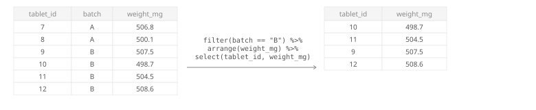




```{=html}
<div class="card-grid subpage-grid">
<a href="importing-data.qmd" class="feature-card">
<div class="card-head">
<div class="card-icon">📥</div>
<h3>Importing Data</h3>
</div>
<p>Read CSV and Excel files into R using <code>read_csv()</code>, <code>read_csv2()</code> and <code>read_excel()</code>.</p>
</a>
<a href="missing-data.qmd" class="feature-card">
<div class="card-head">
<div class="card-icon">❓</div>
<h3>Missing Data</h3>
</div>
<p>How to deal with NA values and empty cells in your data using <code>is.na()</code>, <code>drop_na()</code> and <code>replace_na()</code>.</p>
</a>
<a href="cleaning-data.qmd" class="feature-card">
<div class="card-head">
<div class="card-icon">🧹</div>
<h3>Cleaning Data</h3>
</div>
<p>Fix numbers stored as text, messy labels and duplicate rows using <code>parse_number()</code>, <code>str_trim()</code> and <code>distinct()</code>.</p>
</a>
<a href="working-with-rows.qmd" class="feature-card">
<div class="card-head">
<div class="card-icon">🔎</div>
<h3>Working with Rows</h3>
</div>
<p>Keep, sort and pick rows using <code>filter()</code>, <code>arrange()</code> and <code>slice()</code>.</p>
</a>
<a href="working-with-columns.qmd" class="feature-card">
<div class="card-head">
<div class="card-icon">🏛️</div>
<h3>Working with Columns</h3>
</div>
<p>Choose, rename and calculate columns using <code>select()</code>, <code>rename()</code> and <code>mutate()</code>.</p>
</a>
</div>
```

## What is data handling? {#what-is-data-handling}

Data handling is everything you do to get data into a usable shape before you analyse it: importing it into R, dealing with missing or messy values, and selecting, sorting, and calculating the rows and columns you need.

## Combining steps {#combining-steps}

The subpages above cover individual functions for working with your data. Several of these can be combined using the pipe operator.

```{webr}
library(tidyverse)
tablet_weights <- read_csv("data/tablet_weights.csv")

tablet_weights %>%
  filter(batch == "B") %>%
  arrange(weight_mg) %>%
  select(tablet_id, weight_mg)
```

{width=100%}

## A complete workflow {#complete-workflow}

In pharmaceutical production, quality control (QC) means checking that every batch of a medicine meets its specification before it is released. A routine check is weighing tablets: each tablet should be close to its target weight, otherwise it may contain too little or too much drug.

In this example, a QC lab weighed ibuprofen tablets (target weight 500 mg) from three batches, A, B and C, and exported the results from the balance. The file has instrument information at the top, and some tablets have no reading. The goal is to find out, for each batch, how many tablets are within ±1 % of the 500 mg target.

### Look at the data {#workflow-data}

```{webr}
library(tidyverse)

# Skip the 4 instrument lines at the top of the file and treat the
# missing-value codes as NA. Only the first rows are printed.
weights <- read_csv(
  "data/weights_export.csv",
  skip = 4,
  na = c("", "NA", "N/A", "-")
)

weights
```

### Import, clean, and summarise {#workflow-summary}

```{webr}
library(tidyverse)

# 1. Import: skip the 4 instrument lines and treat the missing-value codes as NA
weights <- read_csv(
  "data/weights_export.csv",
  skip = 4,
  na = c("", "NA", "N/A", "-")
)

# 2. Clean and calculate: drop tablets without a reading,
#    express each weight as % of target, and flag tablets outside ±1 %
qc <- weights %>%
  drop_na(weight_mg) %>%
  mutate(
    pct_target = weight_mg / 500 * 100,
    status = if_else(abs(pct_target - 100) <= 1, "in spec", "out of spec")
  )

# 3. Summarise: one row per batch
qc %>%
  group_by(batch) %>%
  summarise(
    n_tablets = n(),
    mean_weight_mg = round(mean(weight_mg), 1),
    sd_weight_mg = round(sd(weight_mg), 1),
    n_out_of_spec = sum(status == "out of spec")
  )
```

### Plot the result {#workflow-plot}

```{webr}
library(tidyverse)

weights <- read_csv(
  "data/weights_export.csv",
  skip = 4,
  na = c("", "NA", "N/A", "-")
)

qc <- weights %>%
  drop_na(weight_mg) %>%
  mutate(
    pct_target = weight_mg / 500 * 100,
    status = if_else(abs(pct_target - 100) <= 1, "in spec", "out of spec")
  )

# Every tablet as a point, coloured by whether it is in spec
ggplot(qc, aes(x = batch, y = weight_mg, colour = status)) +
  geom_jitter(width = 0.1, size = 3) +
  geom_hline(yintercept = 500, linetype = "dashed") +
  labs(x = "Batch", y = "Weight (mg)", colour = NULL)
```
