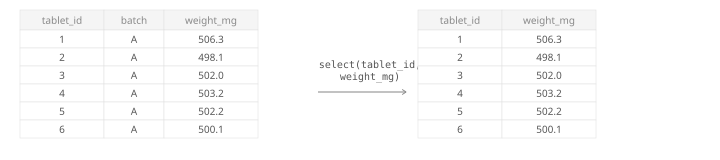
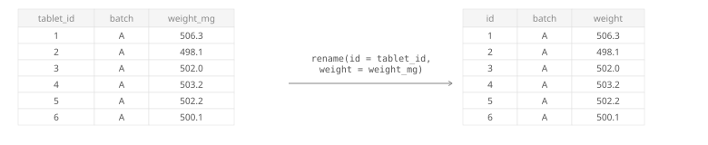
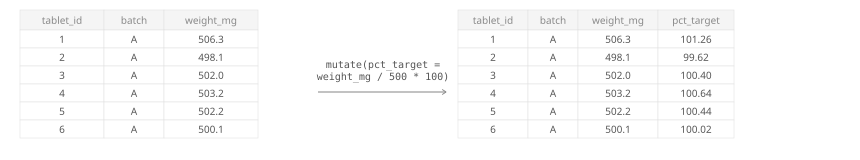




<p class="subpage-back"><a href="data-handling.qmd">← Back to Data Handling</a></p>

## select( ) {#select}

Keep only the columns you need.

### Select columns by name {#select-by-name}

```{webr}
library(tidyverse)
tablet_weights <- read_csv("data/tablet_weights.csv")

tablet_weights %>%
  select(tablet_id, weight_mg)
```

{width=100%}

### Drop a column by name {#select-drop}

```{webr}
# Drop a column with -
library(tidyverse)
tablet_weights <- read_csv("data/tablet_weights.csv")

tablet_weights %>%
  select(-weight_mg)
```

{width=100%}

## rename( ) {#rename}

Rename a column: `rename(new_name = old_name)`.

```{webr}
library(tidyverse)
tablet_weights <- read_csv("data/tablet_weights.csv")

tablet_weights %>%
  rename(id = tablet_id, weight = weight_mg)
```

{width=100%}

## mutate( ) {#mutate}

Add or transform columns. See the full [`mutate()` reference page](../functions/mutate.qmd) for details.

```{webr}
# The target weight is 500 mg — express each tablet as % of target
library(tidyverse)
tablet_weights <- read_csv("data/tablet_weights.csv")

tablet_weights %>%
  mutate(pct_target = weight_mg / 500 * 100)
```

{width=100%}
