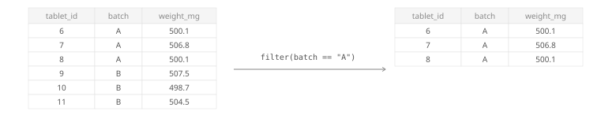
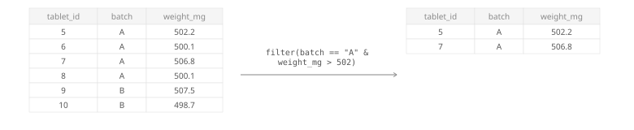
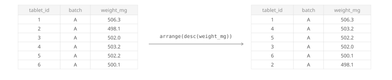




<p class="subpage-back"><a href="data-handling.qmd">← Back to Data Handling</a></p>

## filter( ) {#filter}

Keep only rows where a condition is `TRUE`.

### Filter based on one condition {#filter-one-condition}

```{webr}
# Keep only batch A tablets
library(tidyverse)
tablet_weights <- read_csv("data/tablet_weights.csv")

tablet_weights %>%
  filter(batch == "A")
```

{width=100%}

### Filter based on multiple conditions {#filter-multiple-conditions}

```{webr}
# Keep rows matching two conditions
library(tidyverse)
tablet_weights <- read_csv("data/tablet_weights.csv")

tablet_weights %>%
  filter(batch == "A" & weight_mg > 502)
```

{width=100%}

::: {.callout-tip}
## Available Operators

- `==` **equal** — is the value exactly this?
- `!=` **not equal** — exclude this value
- `>` / `<` **greater / less than** — strictly above or below
- `>=` / `<=` **greater / less than or equal** — includes the boundary value
- `&` **and** — both conditions must be true
- `|` **or** — at least one condition must be true
:::

## arrange( ) {#arrange}

Sort rows by a column.

### Ascending order {#arrange-ascending}

```{webr}
library(tidyverse)
tablet_weights <- read_csv("data/tablet_weights.csv")

tablet_weights %>%
  arrange(weight_mg)
```

{width=100%}

### Descending order {#arrange-descending}

```{webr}
library(tidyverse)
tablet_weights <- read_csv("data/tablet_weights.csv")

tablet_weights %>%
  arrange(desc(weight_mg))
```

{width=100%}

## slice( ) {#slice}
